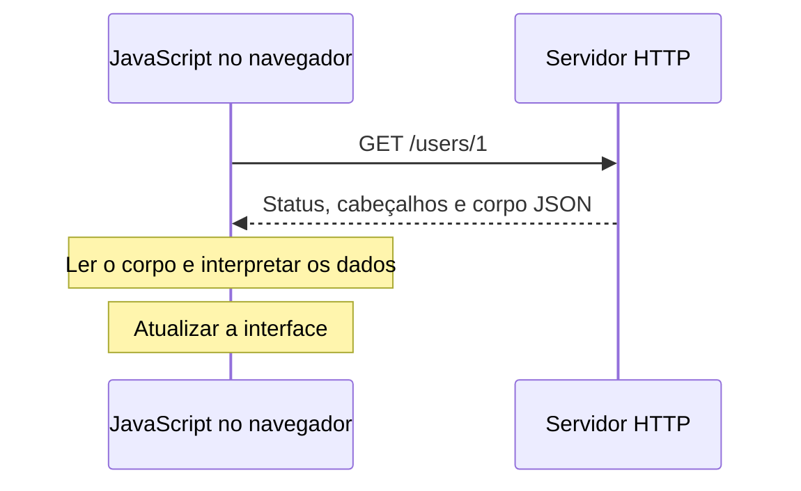

# APIs e JSON: como o JavaScript conversa com o mundo

Aula independente, do básico ao avançado **dentro deste tema**: entender uma API, representar dados em JSON, fazer uma consulta HTTP e tratar a espera e as falhas com JavaScript.

O material original apresenta os conceitos e indica ferramentas e referências, sem fornecer código executável. Os exemplos, a página de prática e os exercícios deste repositório foram elaborados como complementos didáticos.

## Como executar a prática

Esta aula usa `fetch` para ler arquivos e consultar uma API. **Sirva a pasta por HTTP**, em vez de abrir o HTML por duplo clique.

Com Python 3 instalado, abra um terminal na pasta do repositório e execute:

```bash
python -m http.server 8000 --bind 127.0.0.1
```

Dependendo da instalação, o comando é `python3` ou `py`. Acesse **http://127.0.0.1:8000** no navegador. Mantenha o terminal aberto durante a prática; `Ctrl+C` encerra o servidor.

Não é necessário instalar bibliotecas. Python serve os arquivos estáticos; a lógica estudada está no JavaScript do navegador. O arquivo JSON local é uma amostra de dados, não uma API de backend implementada por este projeto.

Comece pela origem local. Depois teste a JSONPlaceholder, que é um serviço público com dados fictícios e consultas sem chave. Essa opção requer conexão com a internet. A página não substitui silenciosamente uma falha externa por dados locais.

## Roteiro do básico ao avançado

1. Entenda a diferença entre API, HTTP e JSON.
2. Experimente `JSON.parse` e `JSON.stringify` sem fazer nenhuma consulta.
3. Leia a amostra local usando `fetch`.
4. Consulte um usuário fictício da API pública.
5. Compare sucesso, erro HTTP e JSON inválido.
6. Observe a ordem assíncrona, cancele uma consulta e teste o tempo limite.
7. Resolva [os exercícios com soluções](./EXERCICIOS.md) e consulte [os recursos verificados](./RECURSOS.md).

Pré-requisitos: reconhecer variáveis, objetos, arrays e funções. Os exemplos de interface também usam seletores e eventos, mas cada operação de consulta pode ser estudada separadamente em [api.js](./api.js).

## 1. Básico — o que é uma API?

API significa *Application Programming Interface*, ou Interface de Programação de Aplicações. Ela define como um programa pode usar funcionalidades ou dados de outro componente.

Uma API não precisa ser um site: o DOM, por exemplo, também oferece uma API. Nesta aula, o foco é uma **API web acessada por HTTP**.

Imagine um catálogo de biblioteca: a interface explica como pedir um livro e quais informações receber. Você não precisa conhecer toda a organização interna para fazer um pedido válido. Da mesma forma, a documentação de uma API descreve caminhos, operações e respostas.

Na prática pública desta aula:

```text
GET https://jsonplaceholder.typicode.com/users/1
```

- `GET` é o método HTTP para consultar o recurso.
- O endereço identifica o serviço e o recurso desejado.
- `/users/1` é o caminho para o usuário de ID 1.
- O servidor responde com um status HTTP, cabeçalhos e um corpo.

| Termo | Significado neste exemplo |
| --- | --- |
| Cliente | O código que faz a consulta no navegador |
| Servidor | O serviço que atende à requisição |
| Endpoint | O ponto de acesso documentado para uma operação |
| Requisição | O pedido enviado ao serviço |
| Resposta | O resultado devolvido pelo serviço |



Uma API web pode responder em JSON, texto, imagens ou outros formatos. **API, HTTP e JSON são conceitos diferentes.**

## 2. Básico — o que é JSON?

JSON significa *JavaScript Object Notation*. É um formato textual de troca de dados, usado também por outras linguagens além de JavaScript.

Exemplo de texto JSON:

```json
{
  "nome": "Ana",
  "ativo": true,
  "pontos": 15,
  "interesses": ["JavaScript", "APIs"],
  "apelido": null
}
```

Regras para reconhecer o formato:

- Chaves de objetos e strings usam aspas duplas.
- Números e booleanos não precisam de aspas.
- JSON aceita objetos, arrays, strings, números, booleanos e `null`.
- Comentários, vírgulas finais, `undefined` e funções não fazem parte da sintaxe JSON.

A raiz pode ser um objeto, um array ou outro valor válido: `42`, `"olá"`, `true` e `null` também são textos JSON válidos.

### Texto JSON e objeto JavaScript

```javascript
const texto = '{"nome":"Ana","ativo":true}';
const pessoa = JSON.parse(texto);

console.log(typeof texto); // string
console.log(typeof pessoa); // object
console.log(pessoa.nome); // Ana
```

`JSON.parse` interpreta o texto e devolve um valor JavaScript. Não envia uma requisição. A operação inversa é a serialização:

```javascript
const pedido = { produto: 'Caneca', quantidade: 2 };
const textoParaEnviar = JSON.stringify(pedido);

console.log(typeof textoParaEnviar); // string
console.log(textoParaEnviar); // {"produto":"Caneca","quantidade":2}
```

`JSON.stringify` também não envia nada: ele prepara uma representação textual. O envio, quando necessário, depende de outra operação, como `fetch`.

Na primeira seção da página, experimente um JSON válido e depois troque as aspas de uma chave por aspas simples. Observe a mensagem de erro e corrija o texto.

## 3. Intermediário — requisição e resposta HTTP

Uma resposta contém informações diferentes:

| Parte | Exemplo | Para que serve |
| --- | --- | --- |
| Status | `200`, `404`, `500` | Informa o resultado HTTP |
| Cabeçalho | `Content-Type: application/json` | Descreve o formato do corpo |
| Corpo | Texto JSON de um usuário | Contém os dados da resposta |

`200` indica sucesso; `404`, recurso não encontrado; `500`, erro no servidor. Há outros códigos documentados para outras situações.

O cabeçalho `Accept` no pedido informa os formatos desejados pelo cliente. `Content-Type` descreve um corpo enviado ou recebido. Um GET sem corpo, como nesta prática, não precisa enviar `Content-Type: application/json`.

### A consulta acontece em duas etapas assíncronas

```javascript
async function consultarAmostra() {
  const resposta = await fetch('./dados/usuario.json');

  if (!resposta.ok) {
    throw new Error('Erro HTTP ' + resposta.status);
  }

  const dados = await resposta.json();
  console.log(dados.name); // Ana Exemplo
  return dados;
}
```

1. `fetch` inicia o pedido e retorna uma Promise.
2. O primeiro `await` espera a disponibilidade da resposta HTTP.
3. `resposta.ok` verifica se o status está na faixa de sucesso, de 200 a 299.
4. `resposta.json()` lê o corpo e o interpreta, retornando outra Promise.
5. O segundo `await` fornece o valor JavaScript já interpretado.

Não faça `JSON.parse(dados)` novamente: nesse ponto os dados já passaram pela interpretação.

A função `buscarJSON` de [api.js](./api.js) organiza essas duas etapas. Quando encontra uma resposta HTTP de erro, lança um erro com `name` igual a `'ErroHTTP'` e uma propriedade `status`. Na interface, `try/catch/finally` decide qual mensagem mostrar e libera os controles ao terminar.

## 4. Intermediário — por que a espera é assíncrona?

Uma operação de rede depende de comunicação e processamento fora do trecho de código que a iniciou. Sua duração não é conhecida de antemão. O resultado pode chegar depois ou a operação pode falhar.

Uma **Promise** representa esse resultado futuro. Ela pode estar pendente, ser resolvida com um valor ou ser rejeitada com um erro. Uma função `async` sempre retorna uma Promise.

`await` suspende a continuação daquela função assíncrona enquanto a Promise está pendente. Ele não trava a página inteira: outros eventos podem continuar sendo processados.

Observe uma simulação local:

```javascript
(async function () {
  console.log('1. Antes de criar a espera');
  const promessa = aguardar(1000);
  console.log('2. Depois de criar a espera');
  await promessa;
  console.log('3. Depois que a espera terminou');
})();
```

`aguardar` usa um temporizador, não uma API remota. A ordem esperada é 1, 2, 3. O atraso é aproximado: o temporizador não garante uma execução no milissegundo exato.

Use o botão Demonstrar ordem assíncrona e, enquanto espera, ative o contador. Depois teste o mesmo contador durante uma consulta com espera simulada.

**Assíncrono não significa automaticamente paralelo.** Duas chamadas aguardadas uma após a outra continuam sequenciais. Além disso, `JSON.parse` e um cálculo longo continuam sendo operações síncronas; colocar `async` em uma função não torna todo seu trabalho instantâneo.

## 5. Avançado — separar os tipos de falha

| Situação | O que acontece | Tratamento da prática |
| --- | --- | --- |
| Resposta HTTP 404 ou 500 | `fetch` normalmente resolve com uma resposta | Verificar `ok` e lançar um erro HTTP |
| Corpo recebido não é JSON válido | A leitura por `resposta.json()` rejeita | Informar erro de formato |
| Falha de rede ou impedimento do navegador | `fetch` pode rejeitar | Mostrar a falha e consultar Console/Network |
| Cancelamento manual | O controlador interrompe a operação | Informar cancelamento |
| Tempo limite atingido | O temporizador dispara o cancelamento | Informar timeout |

Os botões de erro usam o servidor **local**:

- `dados/nao-existe.json` não é um arquivo do projeto; a consulta produz HTTP 404.
- `dados/invalido.txt` existe, mas contém JSON intencionalmente inválido. A resposta pode chegar com sucesso e a interpretação falhar.

Esses testes não provocam erros no serviço público. O texto de uma mensagem nativa de erro pode variar por navegador; os exercícios verificam o tipo e o contexto.

### CORS e o navegador

CORS é o mecanismo pelo qual um servidor informa quais origens podem ler suas respostas no navegador. Uma falha de CORS pode se parecer com uma falha de rede para o código JavaScript. Não conclua que todo `TypeError` é CORS: examine o painel Network e a mensagem do navegador.

`mode: 'no-cors'` não é uma solução para ler JSON bloqueado: ele pode produzir uma resposta opaca, cujo corpo não fica disponível ao código. A solução depende da configuração do serviço ou de uma integração de backend apropriada.

## 6. Avançado — cancelamento e tempo limite

`AbortController` fornece um sinal que pode interromper operações compatíveis:

```javascript
const controlador = new AbortController();
const consulta = buscarJSON('./dados/usuario.json', {
  signal: controlador.signal
});

// Quando for necessário cancelar:
controlador.abort();
consulta.catch(function (erro) {
  console.log(erro.name); // AbortError, se o cancelamento interrompeu a consulta.
});
```

Use um controlador novo por consulta: depois de abortado, seu sinal continua abortado.

A prática registra o motivo antes de chamar `abort()`. Isso permite distinguir o clique em Cancelar de um timeout, embora ambos possam gerar `AbortError`.

O temporizador é sempre limpo em `finally`. Novas consultas ficam desabilitadas durante a atual, evitando que respostas concorrentes sobrescrevam a interface fora de ordem. O contador de interações permanece disponível.

Para testar sem depender da velocidade do serviço público:

1. Selecione **Arquivo local com espera simulada de 2 segundos**.
2. Com limite de `8000` ms, consulte e pressione Cancelar antes do fim da espera.
3. Com limite de `500` ms, consulte novamente e observe o timeout.
4. Volte a `8000` ms e espere a conclusão bem-sucedida.

O atraso é uma simulação **antes** do `fetch`; o tempo limite cobre tanto essa espera didática quanto a consulta e a leitura do corpo. Se você cancelar durante a simulação, a requisição ainda nem terá sido iniciada.

## API pública utilizada

A opção pública faz somente consultas GET à [JSONPlaceholder](https://jsonplaceholder.typicode.com/). Os usuários são fictícios. O ID `1` foi conferido com resposta HTTP 200; o ID `9999` retornou HTTP 404 na verificação desta aula.

O projeto não usa chaves nem exige cadastro para essas consultas. A disponibilidade e a resposta do serviço externo podem mudar. Use a amostra local para repetir os exercícios de forma independente do serviço.

O [public-apis/public-apis](https://github.com/public-apis/public-apis) indicado na aula é um catálogo de APIs, não um endpoint único. Antes de escolher outro serviço, leia sua documentação: autenticação, suporte a CORS e condições de uso variam. Segredos de uma integração devem ficar no backend, não em arquivos enviados ao navegador.

## Erros comuns para revisar

- Chamar todo objeto JavaScript de JSON.
- Usar aspas simples ou vírgula final em um texto JSON.
- Achar que `JSON.stringify` já enviou os dados ao servidor.
- Esquecer o `await` de `resposta.json()`.
- Tratar 404 como sucesso porque `fetch` não lançou um erro automaticamente.
- Interpretar o mesmo corpo duas vezes ou aplicar `JSON.parse` ao valor já interpretado.
- Confundir uma simulação local de espera com latência real do servidor.
- Reutilizar um sinal abortado ou deixar um temporizador pendente após a operação.

## Arquivos e continuação do estudo

| Arquivo | Finalidade |
| --- | --- |
| [index.html](./index.html) e [styles.css](./styles.css) | Interface dos experimentos |
| [api.js](./api.js) | Consulta GET com leitura de JSON e espera simulada |
| [index.js](./index.js) | Conversões, estados e eventos da página |
| [dados/usuario.json](./dados/usuario.json) | Amostra local válida com dados fictícios |
| [dados/invalido.txt](./dados/invalido.txt) | Corpo intencionalmente inválido para o teste |
| [EXERCICIOS.md](./EXERCICIOS.md) | Seis exercícios e um desafio com soluções |
| [RECURSOS.md](./RECURSOS.md) | Documentação, canais e videoaulas verificadas |

ChatGPT e GitHub Copilot são ferramentas opcionais de apoio; Excalidraw pode ajudar a desenhar o fluxo cliente-servidor. Nenhum deles é necessário para executar a prática.

## Verificação do material

Foram conferidos no Chromium as conversões de JSON, a leitura local, os erros HTTP e de formato, a espera simulada, o cancelamento, o timeout e a recuperação da interface. As sete soluções dos exercícios também foram executadas.

O endpoint público retornou HTTP 200 em uma consulta HTTPS real pelo cliente do terminal. No Chromium deste ambiente, a conexão externa foi limitada por um erro de confiança no certificado; por isso, os estados da interface pública foram conferidos com uma resposta controlada e uma falha de rede simulada. Isso distingue a verificação do endpoint da execução completa da chamada externa no navegador.
